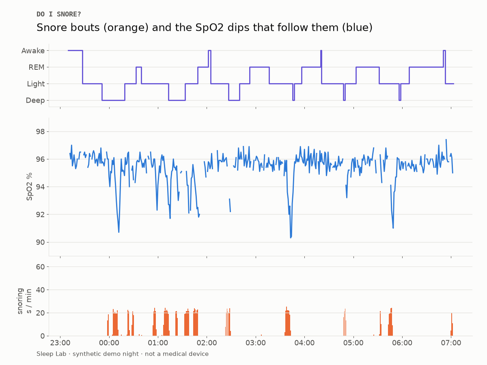

# Do I snore?

Draft. The code works on fake nights; I haven't recorded a real one yet. I'll rewrite this once I have.

Not a medical device. A wrist sensor and an off-the-shelf audio model can't tell you anything clinical about your sleep. If you're actually worried, see a doctor.

## Why

I've been told I snore. I've never heard it. I wear a Fitbit Air to bed, which logs blood oxygen (SpO2) and sleep stages, and my laptop has a mic. Seemed like enough to find out.

The plan: record the room overnight, find the snores, and see if my SpO2 drops after them.

## Setup

- Fitbit Air for sleep stages and SpO2. SpO2 comes in at about one reading a minute, with gaps.
- Laptop mic at 16 kHz.
- YAMNet for the snore detection. It's a pretrained Google audio model with 521 classes, and one of them happens to be "Snoring", so I didn't have to train anything to get started.
- Everything gets put on a 1-minute grid and turned into an HTML report per night.

## Things that went wrong / surprised me

The Fitbit Web API is basically gone. Google moved it to the new Google Health API, and the old one shuts off on October 30th. I found this out four days before that date. So this talks to the new API only. One annoyance: while the Google Cloud app is in testing mode, the login expires every 7 days, so I have to re-auth weekly.

My disk was full. pip install died halfway through. TensorFlow is about 1.5 GB on its own, so I had to clear space before going any further.

I didn't want a full night of bedroom audio sitting on my laptop. So the recorder works a minute at a time: run the detector, save the timestamps, delete the audio. It keeps a few short clips so I can go back and check if a "snore" was actually me or just the heater.

Wrist SpO2 is noisy. If you look after every snore you'll always find some dip. So I compare the average SpO2 after real snore bouts with the average after random moments in the night (300 rounds of that). It only counts if the real dips are bigger than the random ones.

## Results so far

Fake data only. I generated nights where snoring causes a 1–2 point SpO2 drop about a minute later, to check the analysis can actually find something when it's there.

It does. On the heavy-snoring fake night the correlation peaks at about -0.8 with a 3 minute lag, and the average dip is around 2 points, well outside the random baseline. On the quiet fake night it says there's barely anything. So the setup works. Whether I snore is still an open question.

## Next

1. Record at least three real nights.
2. Listen to the saved clips and see how often YAMNet is right.
3. Pull in my Garmin running data, and set up an MCP server so I can just ask Claude how I slept.
